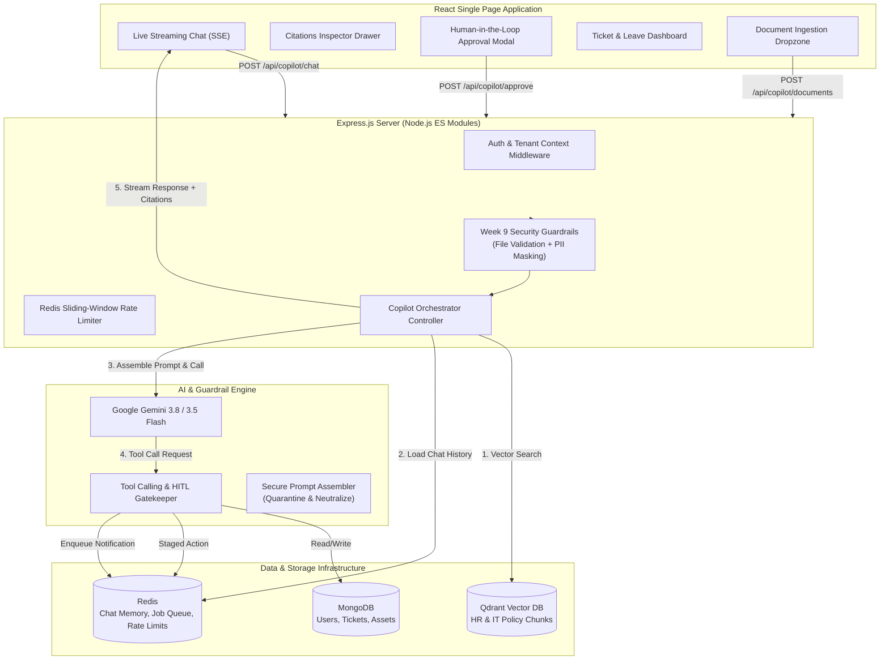
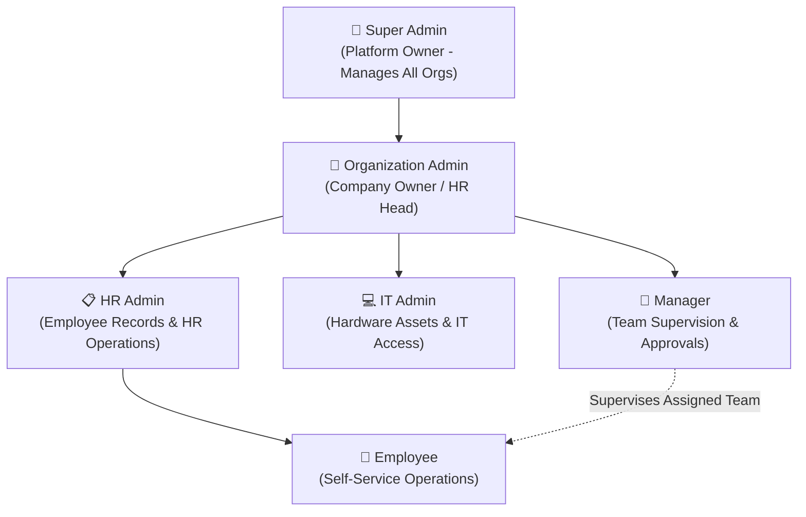
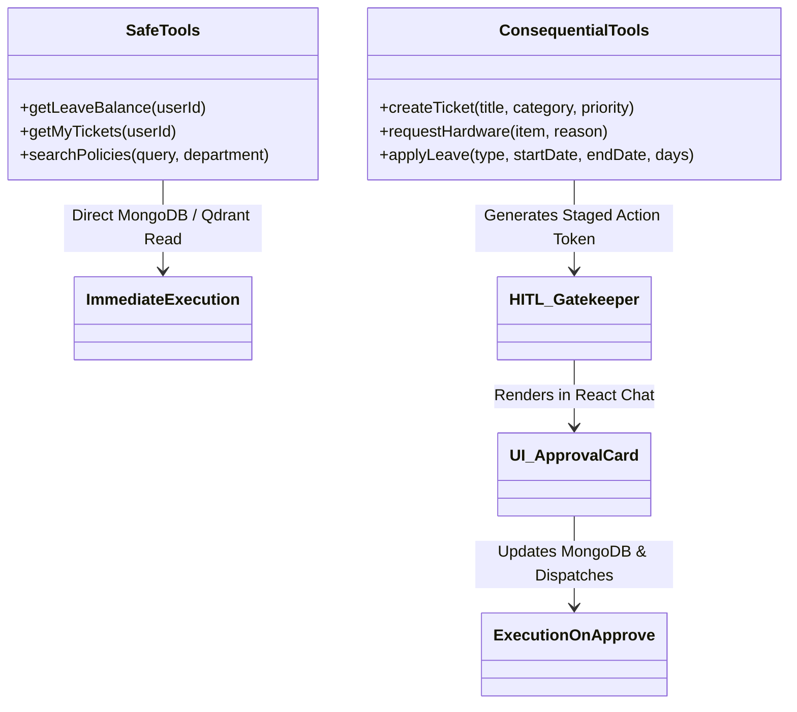
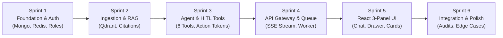

# OmniDesk AI — Enterprise IT & HR Operations Copilot
## Week 10 Product Architecture & Implementation Specification

> **Location:** `C:\vivek-code\Omnidesk-AI`  
> **Mission:** Build a production-grade enterprise copilot that unifies conversational AI, policy retrieval with grounded citations, multi-tenant databases, background queue workers, and human-in-the-loop tool execution into a modern, responsive React interface.

---

## 1. Project Directory Structure

The project will reside entirely in `C:\vivek-code\Omnidesk-AI` with separate `backend` and `frontend` modules:

```text
C:\vivek-code\Omnidesk-AI\
├── backend/
│   ├── src/
│   │   ├── config/              # MongoDB (Mongoose), Qdrant, Redis, Gemini configs
│   │   ├── models/              # Mongoose Schemas (User, Ticket, Asset, AuditLog)
│   │   ├── services/
│   │   │   ├── rag/             # Ingestion, chunking, embeddings & citation extractor
│   │   │   ├── ai/              # Gemini orchestrator, prompt assembly, memory
│   │   │   ├── tools/           # Safe & Consequential tool registry (HITL gates)
│   │   │   └── queue/           # Redis BRPOP worker for async notifications
│   │   ├── security/            # File validation (magic bytes), PII surrogate tokenization
│   │   ├── middlewares/         # Auth/Tenant context, Rate limiter, Request ID, Error handler
│   │   ├── controllers/         # Chat (SSE), Ingestion, Ticket & Approval controllers
│   │   ├── routes/              # Express API routers
│   │   ├── app.js               # Express application configuration
│   │   └── server.js            # Server entry point & graceful shutdown
│   ├── scripts/
│   │   └── seed.js              # Database seed script for initial users, policies & assets
│   ├── .env                     # MongoDB, Redis, Qdrant & Gemini environment variables
│   ├── omnidesk_sprint_plan.md  # Detailed Agile Sprint Plan
│   ├── omnidesk_ai_spec.md      # Full Architectural Specification
│   └── package.json
│
└── frontend/
    ├── src/
    │   ├── components/
    │   │   ├── Chat/            # Streaming chat message list, auto-scroll, prompt bar
    │   │   ├── Citations/       # In-text citation badges & right-side source chunk drawer
    │   │   ├── Actions/         # Interactive staged action approval cards (HITL)
    │   │   ├── Dashboard/       # Left sidebar: user balance, active tickets list
    │   │   └── Upload/          # Document upload dropzone with magic-byte validation feedback
    │   ├── hooks/               # useChat (SSE stream consumer), useTickets, useIngest
    │   ├── services/            # API client for backend endpoints
    │   ├── App.jsx              # 3-Panel Enterprise Layout
    │   ├── main.jsx
    │   └── index.css            # Tailwind styling
    ├── index.html
    ├── vite.config.js           # Vite dev server with proxy to backend (http://localhost:5001)
    ├── tailwind.config.js
    └── package.json
```

---

## 2. System Architecture



---

## 2. Infrastructure Setup (Docker & Standalone)

### 2.1 Primary & Recommended Method: Docker Compose
A unified `docker-compose.yml` is located in the project root (`C:\vivek-code\Omnidesk-AI\docker-compose.yml`). Start all three databases in 1 second:
```bash
docker compose up -d
```
This automatically boots:
* **MongoDB 7.0** on `mongodb://127.0.0.1:27017`
* **Redis 7 (Alpine)** on `redis://127.0.0.1:6380`
* **Qdrant (Vector DB)** on `http://localhost:6333` (Web Dashboard: `http://localhost:6333/dashboard`)

---

### 2.2 Alternative Method: Standalone (Without Docker)
If Docker is not running or you prefer native binaries:
* **Qdrant (6333):** Download `qdrant-x86_64-pc-windows-msvc.zip` from [Qdrant Releases](https://github.com/qdrant/qdrant/releases) and execute `.\qdrant.exe`. (Cloud free tier: [cloud.qdrant.io](https://cloud.qdrant.io)).
* **Redis (6380):** Run standalone `redis-server.exe` from [tporadowski/redis](https://github.com/tporadowski/redis/releases) or [Memurai](https://www.memurai.com). (Cloud free tier: [upstash.com](https://upstash.com)).
* **MongoDB (27017):** Install [MongoDB Community MSI](https://www.mongodb.com/try/download/community). (Cloud free tier: [MongoDB Atlas](https://www.mongodb.com/atlas)).

---

## 3. Core Capabilities Matrix

| Capability | Technical Mechanism | User Experience in UI |
| :--- | :--- | :--- |
| **Evidence-Based RAG** | Qdrant Cosine Similarity search with tenant + department filtering | Answers contain in-text citations like `[Leave Policy §3.2]`. Clicking reveals exact chunk text and match score in the right-side drawer. |
| **Zero-Hallucination Guardrail** | Threshold check (`similarity < 0.65`). Direct fallbacks if info is missing. | When unconfirmed, AI states: *"No company policy covers this topic. Would you like me to raise an HR ticket?"* |
| **Tool Calling & Mutations** | Dynamic function execution against MongoDB (`createTicket`, `getLeaveBalance`) | Live status pills in chat (`⚡ Executing: createTicket...`) followed by formatted card displaying ticket ID and status. |
| **Human-in-the-Loop (HITL)** | Consequential action gating with cryptographic confirmation tokens | Staged actions (e.g., applying 5 days leave or ordering a new laptop) render an interactive card with **Approve** and **Reject** buttons. |
| **Fast Session Memory** | Redis list with token-budgeted sliding window | Switching tabs or refreshing the browser preserves conversation context. Chat can be cleared with one click. |
| **Untrusted Data Defenses** | Week 9 file validation, magic byte header sniffing, PII surrogate tokenization | Malicious disguised `.exe` uploads are rejected instantly. Credit card or salary inquiries mask raw PII before reaching the LLM. |

---

## 3. Data Schema & Models

### 3.1 MongoDB Collections

```javascript
// Organizations Collection (Multi-Tenant Root)
{
  _id: ObjectId("..."),
  orgId: "org_abc",
  name: "ABC Technologies",
  domain: "abctech.com",
  status: "ACTIVE", // 'ACTIVE' | 'SUSPENDED'
  createdAt: ISODate("2026-11-18T10:00:00Z")
}

// Users Collection
{
  _id: ObjectId("..."),
  userId: "emp_101",
  name: "Sarah Jenkins",
  email: "sarah.j@abctech.com",
  orgId: "org_abc",
  department: "Engineering",
  role: "employee", // 'super_admin' | 'org_admin' | 'hr_admin' | 'it_admin' | 'manager' | 'employee'
  managerId: "mgr_201", // References David Miller (manager is also an employee with team supervision)
  status: "ACTIVE",
  leaveBalances: {
    casual: 12,
    sick: 7,
    maternity: 90
  }
}

// Tickets Collection
{
  _id: ObjectId("..."),
  ticketId: "TICK-9041",
  title: "Request for second monitor for home workstation",
  category: "IT_HARDWARE", // 'IT_HARDWARE' | 'IT_ACCESS' | 'HR_BENEFITS' | 'HR_LEAVE'
  priority: "MEDIUM",      // 'LOW' | 'MEDIUM' | 'HIGH' | 'CRITICAL'
  status: "OPEN",          // 'OPEN' | 'PENDING_APPROVAL' | 'RESOLVED'
  userId: "emp_101",
  orgId: "org_abc",
  assignedTo: "mgr_201",
  stagedActionId: "act_xyz789", // Null if direct
  createdAt: ISODate("2026-11-18T10:00:00Z"),
  updatedAt: ISODate("2026-11-18T10:00:00Z")
}

// Assets / Hardware Collection
{
  _id: ObjectId("..."),
  assetTag: "HW-MAC-042",
  type: "LAPTOP",
  model: "MacBook Pro 16\" M3 Max",
  orgId: "org_abc",
  assignedTo: "emp_101",
  status: "ASSIGNED" // 'IN_STOCK' | 'ASSIGNED' | 'RETIRED'
}
```

### 3.2 Qdrant Vector Collection (`omnidesk_policies`)

* **Vector Dimensions:** 768 (Gemini `text-embedding-004`)
* **Distance Metric:** Cosine
* **Payload Fields:**
  * `documentId` (string)
  * `documentName` (e.g., `Employee_Handbook_2026.pdf`)
  * `department` (`HR` | `IT` | `FINANCE`)
  * `sectionTitle` (e.g., `Travel & Meal Reimbursement`)
  * `text` (Raw chunk content)
  * `orgId` (`org_abc`)
  * `allowedRoles` (`['employee', 'manager', 'hr_admin', 'it_admin', 'org_admin']`)

### 3.3 Redis Keyspace Design

* `session:<sessionId>:messages` ➔ List of JSON conversation turns.
* `action:<actionId>` ➔ Staged consequential action payload awaiting approval (TTL: 15 mins).
* `queue:notifications` ➔ List queue for async notification workers.
* `rate_limit:<orgId>:<userId>` ➔ Atomic counter with 60s TTL for abuse prevention.

### 3.4 Authentication & Identity Management

| Method / Feature | Scope | Status in Phase 1 |
| :--- | :--- | :--- |
| **Email + Password Login** | Essential | **Active Implementation**: `POST /api/auth/login` with bcrypt password verification and signed JWT token. Employees log in using company email and password. |
| **Account Provisioning** | Enterprise Internal | **Pre-Seeded / Admin Provisioned**: No public user registration. Employee accounts (e.g. employee, manager, admin) are created through database seed / enterprise provisioning. |
| **Forgot / Reset Password** | Essential | **UI Stub**: Visual Modal/Screen present in the UI with simulated reset link flow (no external SMTP server required in Phase 1). |
| **OAuth (Google / Microsoft)** | Enterprise Convenience | Phase 2 Roadmap |
| **Two-Factor Auth (2FA / TOTP)** | Extra Security | Phase 2 Roadmap |
| **Enterprise SSO (SAML / OIDC)** | Enterprise Customers | Phase 3 Roadmap |

### 3.5 Enterprise Role Hierarchy & RBAC Governance



#### Who Creates Whom Matrix:
| Role | Can Create / Manage | AI Copilot Privileges |
| :--- | :--- | :--- |
| **Super Admin** | Organizations & initial Organization Admins | Platform-wide diagnostics, tenant provisioning |
| **Organization Admin** | HR Admins, IT Admins, Managers, and Employees | Org-wide policy ingestion, all department audits |
| **HR Admin** | Employee records, leave allocations, department assignments | Ingest HR policies, review all leave requests & tickets |
| **IT Admin** | IT assets, hardware inventory, system access grants | Ingest IT policies, approve hardware upgrades |
| **Manager** | Cannot create users; manages assigned team (`managerId`) | View team leave requests, approve/reject team leave actions |
| **Employee** | Cannot create users; self-service only | View own leave balance, own tickets, apply leave, request hardware |

---

## 4. Tool Registry (Agent Capabilities)



1. **`getLeaveBalance`**: Reads employee's available leave days from MongoDB.
2. **`getMyTickets`**: Retrieves existing open tickets for the logged-in user.
3. **`createTicket`**: Opens a new IT or HR ticket. Automatically tags priority based on user urgency.
4. **`requestHardware`** *(Requires Approval)*: Stages a hardware requisition action.
5. **`applyLeave`** *(Requires Approval)*: Deducts days from leave balance upon human confirmation.

---

## 5. React Frontend User Experience Layout

```
+-----------------------------------------------------------------------------------------------+
|  🛡️ OmniDesk AI — Enterprise Operations Copilot                     [Tenant: Alpha] [User: Sarah J] |
+-------------------------------+---------------------------------------+-----------------------+
|  LEFT PANEL: Ops & Navigation |  CENTER PANEL: Conversational Agent   |  RIGHT PANEL: Drawer  |
+-------------------------------+---------------------------------------+-----------------------+
|  👤 My Profile & Balances     |  User: How many casual leaves do I    |  📑 CITATION DETAILS  |
|     Casual: 12  |  Sick: 7    |        have left, and what is the     |  Source:              |
|                               |        notice period for 3+ days?     |  HR_Leave_Policy.pdf  |
|  📋 My Active Tickets         |                                       |                       |
|     #TICK-102: VPN Access     |  AI: You currently have 12 casual     |  Section:             |
|     #TICK-089: Monitor Mount  |      leaves available [1].            |  §3.2 Annual Leaves   |
|                               |                                       |                       |
|  📤 Ingest Policy Document    |      For leave exceeding 2 days,      |  Exact Excerpt:       |
|     + Drop PDF / Policy doc   |      policy requires at least 48      |  "Employees taking 3  |
|     [Upload & Index]          |      hours advance manager notice [2].|  or more consecutive  |
|                               |                                       |  days must give 48h   |
|                               |  [Action Card: Apply 3 Days Leave?]   |  prior notice..."     |
|                               |  Dates: Dec 1 - Dec 3 (3 days)        |                       |
|                               |  [ Approve Action ]  [ Cancel ]       |  Confidence: 94%      |
|                               |---------------------------------------|                       |
|                               |  [ Type your question or request... ] |                       |
+-------------------------------+---------------------------------------+-----------------------+
```

---

## 6. Agile Sprint Execution Plan

The execution is structured into 6 focused feature-driven sprints. Complete sprint breakdown, acceptance criteria, and deliverables are detailed in:
👉 **[omnidesk_sprint_plan.md](file:///C:/vivek-code/Omnidesk-AI/backend/omnidesk_sprint_plan.md)**



* **Sprint 1: Foundation, Multi-Tenant Database & Authentication:** Scaffolding in `C:\vivek-code\Omnidesk-AI`, MongoDB schemas (Org, User, Ticket, Asset), ABC Tech seed data, bcrypt + JWT auth.
* **Sprint 2: Knowledge Ingestion & Evidence-Based RAG Engine:** Qdrant collection, file validation parser, embeddings, semantic retrieval, and citation extractors.
* **Sprint 3: AI Copilot Orchestrator, Tool Registry & Human-in-the-Loop:** Gemini streaming orchestrator, Redis memory, PII surrogate tokenization, 6 core tools, and staged action gatekeeper.
* **Sprint 4: Express API Gateway, SSE Streaming & Background Workers:** SSE streaming chat endpoint, action approve/reject, document ingestion, and Redis notification worker.
* **Sprint 5: React Frontend — 3-Panel Enterprise Copilot UI:** Vite + React SPA, login screen, live streaming chat, in-text citation drawer, and staged action approval cards.
* **Sprint 6: End-to-End Integration, Observability & Polish:** Multi-tier role testing (Super Admin to Employee), audit log viewer, error states, and project documentation.