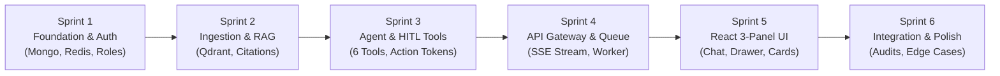

# OmniDesk AI — Engineering Sprint Plan

## Agile Product Roadmap & Sprint-by-Sprint Execution

> **Target Directory:** `C:\vivek-code\Omnidesk-AI`  
> **Architecture:** Modular `backend/` and `frontend/` separation  
> **Methodology:** Feature-driven Agile sprints with concrete deliverables and acceptance criteria.

---



---

## 🛠️ Infrastructure Setup Guide (Docker & Standalone)

### Primary & Recommended: Docker Compose
Run all 3 services via `docker-compose.yml` in the root folder:
```bash
docker compose up -d
```
* **MongoDB (27017)** ➔ Primary database
* **Redis (6380)** ➔ Cache & queues
* **Qdrant (6333)** ➔ Vector database with web GUI at `http://localhost:6333/dashboard`

### Fallback: Standalone (Without Docker)
* **Qdrant (6333):** Standalone `qdrant.exe` from [Qdrant Releases](https://github.com/qdrant/qdrant/releases) or free cloud at [cloud.qdrant.io](https://cloud.qdrant.io).
* **Redis (6380):** Standalone `redis-server.exe` from [tporadowski/redis](https://github.com/tporadowski/redis/releases) or free cloud at [upstash.com](https://upstash.com).
* **MongoDB (27017):** [MongoDB Community MSI](https://www.mongodb.com/try/download/community) or free M0 cluster at [MongoDB Atlas](https://www.mongodb.com/atlas).

---

## 🏃 Sprint 1: Foundation, Multi-Tenant Database & Authentication

### Goal:

Establish the project repository structure, database connections, multi-tenant schemas, pre-seeded enterprise accounts, and secure JWT authentication.

### Deliverables:

1. **Repository Setup:**
   - Scaffolding in `C:\vivek-code\Omnidesk-AI`:
     - `backend/` (Node.js ES Modules, Express, Mongoose, Redis, Qdrant client, Dotenv)
     - `frontend/` (Vite, React, Tailwind CSS, Lucide icons)
2. **Database Configurations:**
   - MongoDB connection with Mongoose (`src/config/db.js`).
   - Redis connection for cache and queues (`src/config/redis.js`).
   - Environment variables template (`.env.example` and `.env`).
3. **Mongoose Models:**
   - `Organization`: Multi-tenant root (`orgId`, `name`, `domain`, `status`).
   - `User`: Multi-tier RBAC (`userId`, `orgId`, `name`, `email`, `passwordHash`, `role`, `managerId`, `leaveBalances`).
   - `Ticket`: Support tickets (`ticketId`, `orgId`, `userId`, `category`, `priority`, `status`, `assignedTo`).
   - `Asset`: Hardware inventory (`assetTag`, `type`, `model`, `orgId`, `assignedTo`, `status`).
4. **Database Seeder (`scripts/seed.js`):**
   - Seeds `ABC Technologies` (`org_abc`).
   - Seeds role hierarchy accounts:
     - `admin@abctech.com` (Organization Admin / HR Admin)
     - `it.admin@abctech.com` (IT Admin)
     - `david.m@abctech.com` (Engineering Manager)
     - `sarah.j@abctech.com` (Employee, reporting to David)
   - Seeds sample inventory (MacBook Pro, 4K Monitor) and baseline tickets.
5. **Authentication & RBAC Middleware:**
   - `POST /api/auth/login`: Verifies email + bcrypt password hash; returns signed JWT (`userId`, `role`, `orgId`, `managerId`).
   - `GET /api/auth/me`: Validates token and returns current user profile and balance.
   - `authMiddleware`: JWT verification and RBAC permission enforcement.

### Definition of Done (Acceptance Criteria):

- [x] Database connects successfully with clean error logging.
- [x] Seed script runs idempotently, creating organization, users, assets, and tickets.
- [x] Sarah (Employee) and David (Manager) can log in via API and receive valid JWTs containing their correct roles and `orgId`.
- [x] Verified via `test-sprint1.js` (20/20 acceptance tests passed).

---

## 🏃 Sprint 2: Knowledge Ingestion & Evidence-Based RAG Engine

### Goal:

Build the Qdrant vector database collection, document ingestion pipeline with file validation, semantic search, and in-text citation extraction.

### Deliverables:

1. **Qdrant Vector Setup:**
   - Initialize collection `omnidesk_policies` with 768-dim vectors (Cosine similarity).
   - Configure payload indexes on `orgId` and `department`.
2. **Document Ingestion Service (`src/services/rag/ingestion.service.js`):**
   - Week 9 File Validation (magic bytes check, MIME sniffing, anti-path traversal, size limits).
   - Text extraction from PDFs and Markdown files.
   - Sliding-window chunking (500 tokens with 50-token overlap).
   - Gemini Embeddings (`text-embedding-004`) batching.
3. **Retrieval & Zero-Hallucination Guardrail (`src/services/rag/retrieval.service.js`):**
   - Tenant-isolated semantic search: `orgId == user.orgId`.
   - Similarity threshold filter (`score >= 0.65`).
   - Fallback trigger when no relevant policy is found.
4. **Citation Formatter (`src/services/rag/citation.service.js`):**
   - Formats retrieved chunks into standardized citation references: `[DocName §SectionTitle]`.
   - Stores citation payload (chunk ID, exact excerpt, match confidence percentage, page/section).

### Definition of Done (Acceptance Criteria):

- [x] Uploading an `.exe` disguised as `.pdf` is blocked by magic byte validation.
- [x] Sample HR Leave Policy and IT Hardware Policy are chunked and indexed into Qdrant.
- [x] Semantic queries return accurate chunks with similarity scores >= 0.65.
- [x] Out-of-scope queries safely return zero results without hallucinating.

---

## 🏃 Sprint 3: AI Copilot Orchestrator, Tool Registry & Human-in-the-Loop (HITL)

### Goal:

Implement the Gemini conversational agent with multi-turn Redis memory, Week 9 PII redaction, 6 core business tools, and cryptographic confirmation gates for consequential actions.

### Deliverables:

1. **AI Agent Core (`src/services/ai/orchestrator.service.js`):**
   - Gemini 3.8 / 3.5 Flash integration with system prompt enforcing role boundaries and in-text citations.
   - Redis sliding-window session memory (`session:<sessionId>:messages`).
2. **PII Masking & Surrogate Tokenization:**
   - Pre-LLM surrogate tokenization (`[SALARY_1]`, `[CREDIT_CARD_1]`, `[PHONE_1]`).
   - Post-LLM de-tokenization to restore values in final response.
3. **6 Core Tools Implementation:**
   - **`searchPolicies`** (Safe): Queries Qdrant for policy answers.
   - **`getLeaveBalance`** (Safe): Queries MongoDB for user's leave balance.
   - **`getMyTickets`** (Safe): Queries MongoDB for user's active/past tickets.
   - **`createTicket`** (Write): Inserts a new support ticket in MongoDB.
   - **`applyLeave`** (Consequential / HITL): Validates balance, stages action token in Redis (`action:act_...`, 15-min TTL).
   - **`requestHardwareUpgrade`** (Consequential / HITL): Validates asset policy, stages hardware order action token.
4. **HITL Action Gatekeeper (`src/services/tools/hitlGatekeeper.service.js`):**
   - Generates secure confirmation token for consequential tools.
   - Returns staged action metadata for the frontend approval card.
   - `consumeActionToken`: Executes mutation on MongoDB only after explicit approval.

### Definition of Done (Acceptance Criteria):

- [x] LLM answers policy queries using RAG and includes citation tags.
- [x] Calling `applyLeave` does NOT immediately alter database balance; it returns a staged action token.
- [x] Calling approval with the token executes the balance deduction in MongoDB.

---

## 🏃 Sprint 4: Express API Gateway, SSE Streaming & Background Workers

### Goal:

Wire all backend modules into high-performance Express REST endpoints, Server-Sent Events (SSE) streaming, and Redis background workers.

### Deliverables:

1. **Streaming Chat Endpoint (`POST /api/copilot/chat`):**
   - Server-Sent Events (SSE) streaming: streams response tokens in real-time.
   - Emits structured SSE events:
     - `event: token` (text token chunk)
     - `event: tool_call` (status: "Searching policy..." or "Checking tickets...")
     - `event: citation` (full citation metadata payload)
     - `event: action_required` (staged action card payload)
     - `event: done`
2. **Action Confirmation Endpoints:**
   - `POST /api/copilot/action/approve`: Consumes action token and commits mutation.
   - `POST /api/copilot/action/reject`: Cancels staged action.
3. **Document Ingestion Endpoint:**
   - `POST /api/copilot/documents`: Multipart file upload with Multer and Week 9 validation.
4. **Tickets & Balance Endpoints:**
   - `GET /api/tickets`: Lists user's tickets (or all org tickets for Admin).
   - `GET /api/profile/balance`: Returns current employee leave quota.
5. **Redis Queue Background Worker (`src/services/queue/notificationWorker.js`):**
   - Consumer loop using Redis `BRPOP` on `queue:notifications`.
   - Simulates dispatching notification emails on ticket creation or leave approvals.

### Definition of Done (Acceptance Criteria):

- [x] Chat endpoint streams SSE tokens smoothly to curl/Postman.
- [x] Ingestion endpoint uploads, validates, and indexes PDFs into Qdrant.
- [x] Background worker logs asynchronous notification delivery when actions are approved.

---

## 🏃 Sprint 5: React Frontend — 3-Panel Enterprise Copilot UI

### Goal:

Build the production React single-page application (Vite + Tailwind CSS) tightly integrated with the Express API Gateway, real-time SSE streaming pipeline, interactive citation drawer, HITL confirmation cards, and live leave/ticket operations.

### Frontend Architecture & Stack:

- **Framework & Build:** React 18 + Vite SPA
- **Styling & UI:** Tailwind CSS + Lucide React icon library
- **Networking:** Native `fetch` with `ReadableStream` reader for SSE streaming; Axios with dual-token interceptor for REST APIs
- **State Architecture:** React Context (`AuthContext`, `CopilotContext`, `NotificationContext`)
- **Target Folder Structure (`frontend/src/`):**
  - `components/layout/`: `AppLayout.jsx`, `Header.jsx`, `LeftOpsPanel.jsx`, `RightCitationDrawer.jsx`
  - `components/chat/`: `ChatContainer.jsx`, `ChatMessage.jsx`, `ChatInput.jsx`, `ToolStatusPill.jsx`, `PromptChips.jsx`
  - `components/cards/`: `HitlApprovalCard.jsx`, `TicketCard.jsx`, `LeaveBalanceCard.jsx`
  - `components/ops/`: `TicketList.jsx`, `DocumentDropzone.jsx`, `CreateTicketModal.jsx`
  - `context/`: `AuthContext.jsx`, `CopilotContext.jsx`
  - `hooks/`: `useSSEChat.js`, `useTickets.js`, `useLeaveBalance.js`
  - `services/`: `api.js`, `copilotService.js`

### Deliverables:

1. **Authentication & RBAC Session Management:**
   - **Split-Screen Enterprise Login:** Corporate Email + Password inputs with instant error validation.
   - **1-Click Role Switcher (Demo Accelerator):** Quick buttons to instantly log in as:
     - 👤 **Sarah Jenkins** (`sarah.j@abctech.com`) — Standard Employee
     - 👔 **David Miller** (`david.m@abctech.com`) — Engineering Manager
     - 🛠️ **Marcus Vance** (`it.admin@abctech.com`) — IT Admin
     - 📋 **Alex Morgan** (`hr.admin@abctech.com`) — HR Admin
   - **Dual-Token Auth Interceptor:**
     - Stores short-lived Access Token in memory/session and Refresh Token in storage.
     - Transparently calls `POST /api/auth/refresh` on `401 Unauthorized` responses.
     - Instant logout via `POST /api/auth/logout`.

2. **3-Panel Enterprise Operations Layout:**
   - **Left Panel (Ops, Navigation & Live Quotas):**
     - **User Profile Banner:** Avatar, Full Name, Department badge, and RBAC Role chip.
     - **Live Leave Quota Widget (`GET /api/profile/balance`):**
       - Circular/bar progress cards for Casual (`X/12`), Sick (`Y/7`), and Maternity (`Z/90`).
       - Auto-refreshes immediately when a leave action is approved.
     - **Ticket Center (`GET /api/tickets` & `POST /api/tickets`):**
       - Displays user tickets (or organization-wide tickets for Managers/Admins).
       - Priority pills (`CRITICAL` red, `HIGH` orange, `MEDIUM` blue, `LOW` gray).
       - Category chips (`IT_HARDWARE`, `HR_LEAVE`, `IT_ACCESS`, `GENERAL`).
       - "+ New Ticket" modal button triggering direct ticket creation.
     - **Policy Document Dropzone (`POST /api/copilot/documents`):**
       - Visible to Admins & Managers.
       - Drag-and-drop zone with client-side file size and extension checks (.pdf, .md, .txt).
       - Ingestion progress bar and Qdrant indexing success toast.
   - **Center Panel (Interactive Agent Chat & SSE Pipeline):**
     - **Session Header:** Current Session ID indicator, Gemini 3.8 Flash model status badge, and "Clear Chat" action.
     - **SSE Streaming Hook (`useSSEChat`):**
       - Connects to `POST /api/copilot/chat` with JWT Bearer authentication.
       - Handles incoming SSE stream events:
         - `event: tool_call` ➔ Renders animated pulsing pill (`"🔍 Searching policy handbook..."` or `"🎫 Checking open tickets..."`).
         - `event: token` ➔ Streams typewriter response smoothly using delta text.
         - `event: citation` ➔ Converts `[1]`, `[2]` tags in text into clickable interactive citation badges.
         - `event: action_required` ➔ Embeds full **HITL Staged Action Card**.
         - `event: done` ➔ Finalizes turn, enables chat input, updates session memory.
         - `event: error` ➔ Displays graceful inline retry banner.
     - **Human-in-the-Loop (HITL) Action Confirmation Card:**
       - Danger/Warning amber accent border with 15-minute live countdown timer (`expiresAt`).
       - Structured details table: Leave Type, Start/End Dates, Days Deducted, Remaining Balance After Approval, Reason.
       - Interactive action buttons:
         - `[Approve & Execute]` ➔ Calls `POST /api/copilot/action/approve`; updates card to "✅ Confirmed & Executed" and triggers live balance decrement on Left Panel.
         - `[Reject]` ➔ Calls `POST /api/copilot/action/reject`; cancels action with "❌ Cancelled" state.
     - **Quick Prompt Chips:**
       - One-click sample questions: *"What is our casual leave policy?"*, *"How many leaves do I have left?"*, *"Apply 2 days casual leave starting next Monday"*, *"Request MacBook Pro refresh"*.
   - **Right Panel (Interactive Evidence & Citation Drawer):**
     - Sliding context drawer that glides open when clicking any in-text citation badge `[1]`.
     - **Document & Section Header:** Formatted label (e.g. `[Employee Handbook 2026 § Casual Leave Guidelines]`).
     - **Match Confidence Meter:** Visual colored score bar (e.g. `92% Match Score`).
     - **Highlighted Evidence Excerpt:** Verbatim chunk text with keyword background highlight.
     - **Audit Metadata:** Organization ID, Department, Allowed RBAC Roles, and Qdrant Chunk Point ID.

3. **Notification Center & Live Data Synchronization:**
   - Top Header **Notification Bell (🔔)** with unread badge counter.
   - Optimistic state updates and cross-component refetch hooks: Approving a leave action or creating a ticket automatically triggers `refetchBalance()` and `refetchTickets()` without full page reload.
   - Manager View Tab: David (Manager) can toggle between "My Tickets" and "Team Requests" to review pending employee actions.

### Definition of Done (Acceptance Criteria):

- [x] Logging in as Sarah (Employee) or Marcus (Admin) displays their specific identity, leave balances, and tickets.
- [x] Asking a policy question streams Gemini response tokens in real-time with pulsing tool status pills.
- [x] In-text citation badges (`[1]`, `[2]`) open the right-side evidence drawer displaying exact Qdrant text and confidence scores.
- [x] Asking to apply for leave renders the HITL Staged Action Card; clicking "Approve" deducts the balance live on the Left Panel.
- [x] Document dropzone uploads a policy file to `POST /api/copilot/documents` and confirms vector indexing into Qdrant.

---

## 🏃 Sprint 6: End-to-End Integration, Observability & Polish

### Goal:

Perform rigorous role-based testing across all 5 tiers (Super Admin to Employee), verify error states, audit logs, and polish UX aesthetics.

### Deliverables:

1. **End-to-End Role Verification:**
   - **Employee (Sarah):** Can check leaves, apply leave, request hardware; blocked from admin tools.
   - **Manager (David):** Can review and approve team leave requests.
   - **IT Admin:** Can upload IT policies, manage hardware assets.
   - **HR Admin / Org Admin:** Can upload HR handbooks, view all employee balances and tickets.
2. **Audit Logging & Telemetry:**
   - Viewing cryptographic SHA-256 audit logs of tool executions and approvals.
3. **Resilience & Error Handling:**
   - Graceful UI handling for model timeout (fallback model).
   - Invalid file upload rejection notifications.
   - Token cost and latency display in telemetry.
4. **Documentation & Run Instructions:**
   - Comprehensive `README.md` in `C:\vivek-code\Omnidesk-AI` with setup, environment config, and testing walkthrough.

### Definition of Done (Acceptance Criteria):

- [ ] Zero console errors during normal usage.
- [ ] All 6 tools tested across appropriate roles.
- [ ] Complete product demo ready for presentation.
